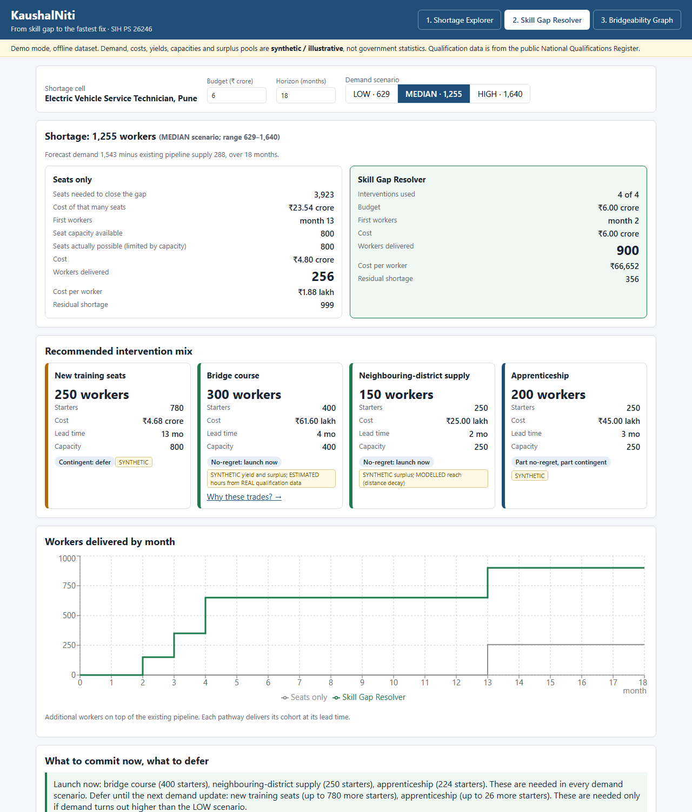
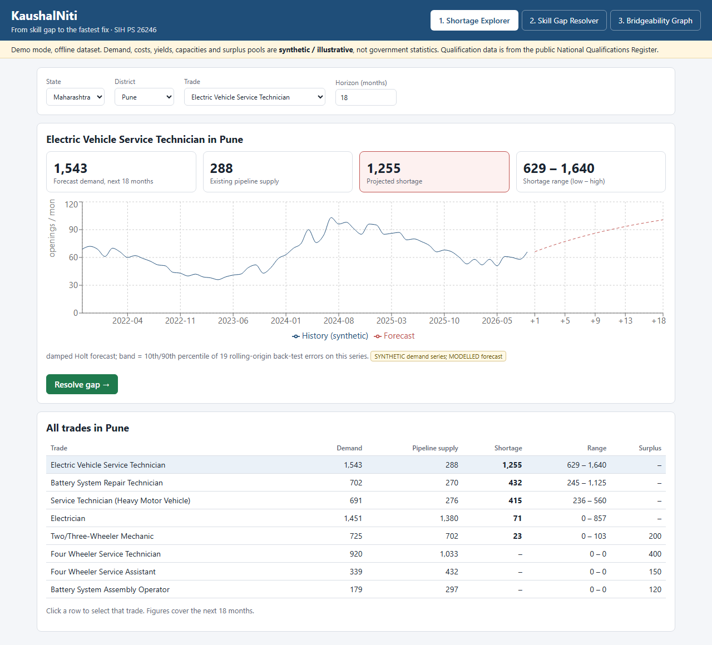
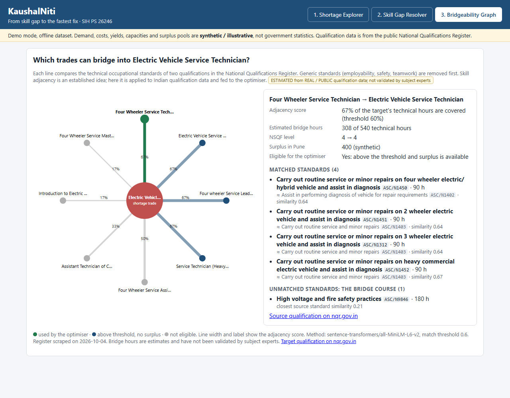

# KaushalNiti

**From skill gap to the fastest fix.**

Smart India Hackathon · Problem Statement **26246** · *AI-Enabled Labour Market Intelligence and Skill Demand-Supply Forecasting Engine* · Ministry of Skill Development and Entrepreneurship (MSDE)

> **Demo demand, costs, yields, surplus pools and other unavailable district-level values are synthetic/illustrative and are explicitly labelled.** They are not government statistics. Qualification data is real and comes from the public National Qualifications Register.



## 1. Problem statement

Labour-market information in India sits in separate systems: job-market signals, NCO/NSQF classifications, PLFS, e-Shram, NCS, PMKVY and ITI training data, apprenticeship records and one-off district skill-gap studies. The problem statement asks for an engine that brings demand and supply together and forecasts the gap.

## 2. Problem context

A planner can often be told that a district and trade is short of workers. The harder question is what to do about it. The usual answer, "create that many training seats", is slow (a seat sanctioned today produces a worker a year or more later), limited by instructors and labs, and cannot be undone if the forecast was wrong.

## 3. Solution

KaushalNiti treats training seats as one of four ways to supply a shortage:

| Intervention | What it is |
|---|---|
| New training seats | More capacity in the shortage trade |
| Bridge course | A short course for surplus graduates of an adjacent trade |
| Neighbouring-district supply | Surplus graduates of the same trade in nearby districts |
| Apprenticeship | Employer apprenticeship slots |

An optimiser picks the mix that leaves the least unmet demand for the least cost, under budget, capacity, surplus-availability and lead-time limits. It does this for a LOW, MEDIAN and HIGH demand scenario and then says which parts of the plan are needed in every scenario and which only in some.

## 4. Unique identifier

A district planner gets a costed, time-phased mix of seats, bridge courses, neighbouring-district supply and apprenticeships for a forecast shortage, plus which parts are safe to launch now and which should be deferred.

## 5. The Skill Gap Resolver

For the demo cell (Pune, Electric Vehicle Service Technician, ₹6 crore, 18 months) the app computes, from the synthetic dataset:

| | Seats only | Skill Gap Resolver |
|---|---|---|
| What closing the gap would take | 3,923 seats, ₹23.54 crore | – |
| What budget and capacity allow | 800 seats | 400 bridge, 250 neighbour, 250 apprenticeship, 780 seats |
| Workers delivered | 256 | 900 |
| Workers on the job by month 4 | 0 | 650 |
| Cost | ₹4.80 crore | ₹6.00 crore |
| Cost per worker | ₹1.88 lakh | ₹0.67 lakh |
| Residual shortage (of 1,255) | 999 | 356 |

In the LOW scenario (shortage 629) the plan uses **no new seats** and closes the gap for ₹1.27 crore. The app therefore recommends launching the three short-cycle interventions now and deferring seat expansion. Committing to the MEDIAN plan and then seeing LOW demand would cost ₹4.73 crore of regret, nearly all of it seats that were not needed.

These figures are an illustration under stated assumptions, not a real-world finding. Nothing above is stored: change a parameter and every number is recomputed.

## 6. Architecture

```
Data sources (register scrape, demo CSVs)
        ↓
Demand forecast + back-tested scenarios      Bridgeability graph (cached)
        ↓                                            ↓
Gap = demand − pipeline supply       Surplus pools + distance-decay reach
        └──────────────┬─────────────────────────────┘
                 Skill Gap Resolver (scenario linear programme)
                       ↓
        Regret · no-regret / contingent split · explanation
                       ↓
                 FastAPI  →  React (3 screens)
```

One Python package, one container. Details: [docs/architecture.md](docs/architecture.md).

## 7. Screens

| Shortage Explorer | Bridgeability Graph |
|---|---|
|  |  |

## 8. Demo workflow

The two-minute script is in [docs/demo.md](docs/demo.md). In short: select Pune and EV Service Technician → see the shortage → compare seats-only with the resolver → switch to LOW and watch new seats drop to zero → open the graph to see why Four Wheeler Service Technicians can bridge → export the plan.

## 9. Optimisation methodology

A linear programme solved with HiGHS (via SciPy), once per scenario and once probability-weighted.

- **Decision variables:** starters on each pathway; unmet demand per shortage cell and scenario.
- **Objective:** intervention cost + penalty × unmet demand.
- **Constraints:** residual gap, one shared budget, capacity per intervention type, shared surplus pools, and a deadline (a pathway slower than the horizon cannot be used).
- **Regret:** cost of a plan in a scenario minus the best achievable in that scenario.
- **No-regret / contingent:** starters needed in every scenario versus only in some.

Several shortages can be planned together; they then compete for the same budget and the same surplus graduates. Full formulation: [docs/methodology.md](docs/methodology.md).

## 10. Adjacency methodology

Skill adjacency is an established concept. KaushalNiti applies it to Indian qualification data and feeds it to the optimiser.

1. Take each qualification's occupational standards from the register.
2. Drop generic ones (employability, workplace safety, teamwork, and any code reused very widely).
3. Embed the titles of the technical standards (`all-MiniLM-L6-v2`) and match each target standard to its closest source standard.
4. Score = share of the target's technical hours that found a match. Bridge hours = unmatched hours plus a top-up on matched ones.
5. A pathway is eligible only if the score clears the threshold, both qualifications are in the same sector, and the source is at most one NSQF level below the target.

Example from the real register: *Four Wheeler Service Technician → Electric Vehicle Service Technician* scores 67%; the unmatched standard is "High voltage and fire safety practices" (180 hours), and the estimated bridge is 308 hours.

A desk review of 51 pairs agreed with the model on 42 (22 accepted pairs found, 9 missed, none wrongly accepted). The review was AI-assisted, not by subject experts, and the two guards were added after seeing errors in this same sample, so treat this as a sanity check rather than a validation. See [docs/methodology.md](docs/methodology.md).

## 11. Data sources

| Data | Status |
|---|---|
| 480 qualifications and their standards (Automotive, Capital Goods, Electronics, Power) from nqr.gov.in | REAL / PUBLIC |
| District names and headquarters coordinates | REAL / PUBLIC (approximate) |
| Bridgeability scores and bridge hours | ESTIMATED from the register |
| Forecast, scenario band, neighbouring-district reach | MODELLED |
| Demand history, training capacity, surplus pools, intervention costs, yields and capacities | SYNTHETIC |

Dictionary and provenance: [docs/data.md](docs/data.md), also served at `/api/data-status`.

## 12. Real vs synthetic data

No official source publishes trade-level demand by district, surplus graduates by trade, or per-intervention costs and yields, so those are synthetic and tagged as such in the UI, the API and the export. KaushalNiti uses no live NCS, SIDH, EPFO or e-Shram feed. Mobility is a distance model because the Census publishes no district-to-district flows. PMKVY and NAPS district files are public but sit behind a download form; where they would plug in is documented in [docs/data.md](docs/data.md).

## 13. Technology stack

- **Backend:** Python 3.11, FastAPI, SciPy (HiGHS), NumPy, pandas, scikit-learn
- **Graph build (offline, optional):** sentence-transformers
- **Frontend:** React 18, TypeScript, Vite, Recharts
- **Storage:** CSV and JSON files in the repository. No database: the dataset is a few thousand rows.
- **Deployment:** one Docker image

## 14. Repository structure

```
backend/kaushalniti/   resolver.py   optimiser, baseline, regret, classification
                       forecast.py   forecast and scenarios
                       adjacency.py  bridgeability graph builder
                       data.py       loads data, assembles optimiser problems
                       service.py    plan assembly and explanations
                       api.py        FastAPI endpoints
backend/tests/         60 tests
frontend/src/          App, three pages, API client, tests
data/demo/             synthetic demo dataset (CSV, JSON)
data/processed/        register extract and cached graph
data/metadata/         provenance and the adjacency review sheet
scripts/               scrape_nqr.py, generate_demo_data.py, validate_adjacency.py
docs/                  architecture, methodology, data, API, demo
```

## 15. Installation

Requires Python 3.11+ and Node 20+ (or just Docker).

```bash
git clone <repository-url>
cd kaushalniti
python -m venv backend/.venv
backend/.venv/bin/pip install -r backend/requirements-dev.txt        # Windows: backend\.venv\Scripts\pip
cd frontend && npm ci && cd ..
```

## 16. Local execution

```bash
# terminal 1: API on http://localhost:8000
cd backend
.venv/bin/python -m uvicorn kaushalniti.api:app --reload             # Windows: .venv\Scripts\python

# terminal 2: UI on http://localhost:5173 (proxies /api to :8000)
cd frontend
npm run dev
```

Or build the UI once (`npm run build` in `frontend/`) and open http://localhost:8000; FastAPI serves it.

## 17. Demo execution

```bash
docker compose up --build        # then open http://localhost:8000
```

The demo needs no internet, no API keys and no government service. The same inputs always give the same plan.

## 18. API

| Method | Path | Purpose |
|---|---|---|
| GET | `/api/health` | Liveness and dataset size |
| GET | `/api/meta` | Selectors and default assumptions |
| GET | `/api/gap` | Forecast gap for one cell, or all cells in a district or state |
| GET | `/api/scenarios` | How LOW / MEDIAN / HIGH are built |
| POST | `/api/resolve` | Run the resolver |
| GET | `/api/adjacency/{trade}` | Source trades, matched and unmatched standards |
| GET | `/api/data-status` | Provenance of every dataset |

Interactive documentation is at `/docs` when the server is running. Examples: [docs/api.md](docs/api.md).

## 19. Testing

```bash
cd backend && .venv/bin/python -m pytest      # 60 tests: optimiser, forecast, adjacency, API, end-to-end demo
cd frontend && npm test                       # 4 tests: screens, API integration, export
```

The end-to-end test runs Pune / EV Service Technician / ₹6 crore / 18 months and checks that budget, capacity, shared surplus and deadline hold, not that a fixed number comes out.

## 20. Deployment

`docker build -t kaushalniti . && docker run -p 8000:8000 kaushalniti` on any host that runs containers. Configuration is optional and listed in [.env.example](.env.example). There is no authentication: put it behind your own access control if it is exposed.

## 21. Limitations

- Demand, costs, yields, capacities and surplus pools are synthetic. The headline comparison is an illustration.
- Adjacency uses standard titles only. It misses real neighbours whose standards are worded differently (the review found 9 misses in 51 pairs) and bridge hours are not validated course lengths.
- The scenario band is back-tested on a synthetic series and says nothing about real forecast accuracy.
- Mobility is a distance-decay model, not observed movement.
- Each pathway delivers its whole cohort at its lead time; intake batches are not modelled.
- The register extract covers four sectors and can lag the live register. NCO codes are not captured.
- One state and eight trades. Hindi interface, map and PDF export are not built.

## 22. Responsible claims

We do say:
- We found no public system or SIH repository in our search that optimises a mix of intervention types for a district-trade shortage.
- Skill adjacency is an established concept; KaushalNiti applies it to Indian qualification data.
- Under stated assumptions, the optimiser can deliver workers earlier or reduce residual shortage compared with a seats-only baseline.

We do not say that this is first in the world, that we invented skill adjacency, that we use real-time NCS or SIDH data, that district demand is official, that mobility is observed, or that bridge durations are validated.

## 23. Future work

- Replace synthetic inputs with PMKVY, NAPS, ITI and PLFS data where access allows.
- Expert review of adjacency pairs; use full standard text (performance criteria), not just titles.
- Calibrate the mobility model on Census table B-28.
- Phase cohorts by intake batch; add a multi-period model.
- Hindi interface and a district map.

## 24. Licence

Code: MIT. The register extract remains subject to nqr.gov.in terms; see [LICENSE](LICENSE).
