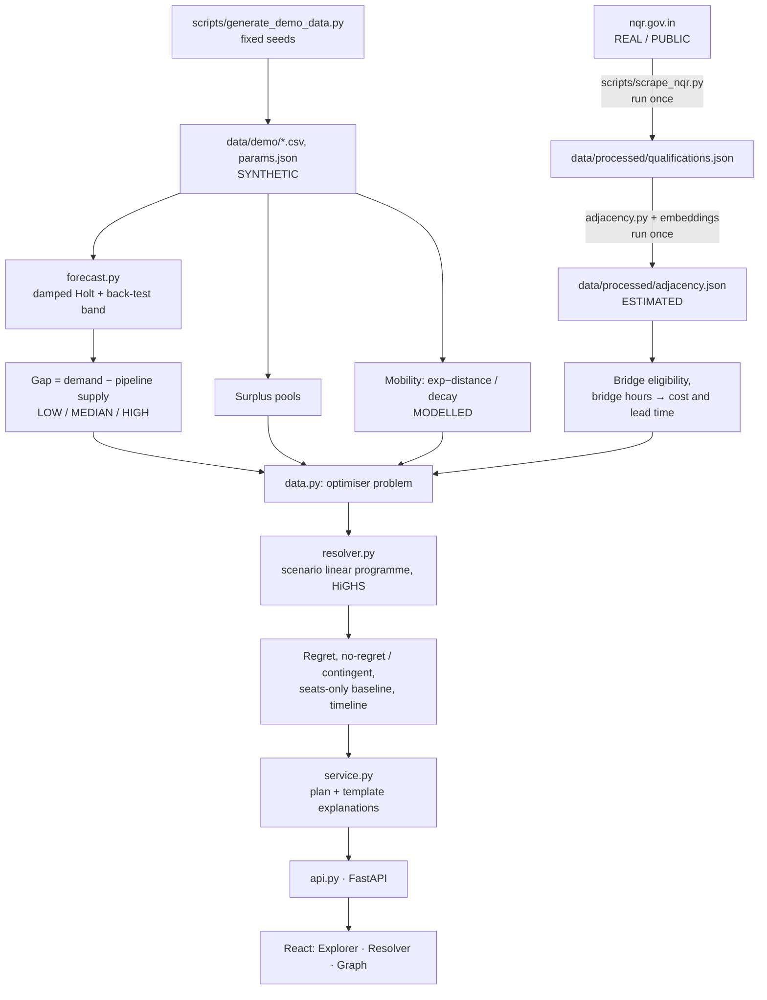

# Architecture

## Design decisions

| Decision | Reason |
|---|---|
| The optimiser has no I/O and knows nothing about files, HTTP or the UI | It can be tested with hand-checkable numbers and reused outside the app |
| CSV and JSON files instead of a database | A few thousand rows; files are diffable, need no service, and make the demo reproducible |
| Adjacency is precomputed and committed | The demo runs offline with no model download; the embedding model is a build-time dependency only |
| One container; FastAPI serves the built frontend | Nothing to orchestrate |
| Explanations are templates over optimiser output | Every number in a sentence is one the optimiser produced; no language model can alter them |
| No authentication | Out of scope for a demo with no personal data; deploy behind existing access control |

## Request flow for `POST /api/resolve`

1. `api.py` validates the request (budget, horizon, scenario, known district and trade, override ranges).
2. `data.py` builds the problem: scenario demands from the forecast, pipeline supply, then pathways for each cell. New seats and apprenticeship come from the intervention table. Bridge pathways come from eligible graph edges whose source trade has surplus in the district. Neighbour pathways come from other districts with surplus in the same trade, capped by distance-decay reach.
3. `resolver.py` solves the LOW, MEDIAN and HIGH plans and the probability-weighted plan, rounds them, and computes regret and the no-regret split.
4. `service.py` adds the seats-only baseline, timeline, binding constraints, explanation and the assumptions with their provenance.

## Security notes

- No secrets exist in the project; nothing in `.env.example` is required.
- All inputs are validated by Pydantic; unknown places and trades return 404.
- The API reads only its own data folder and executes no user-supplied code or paths.
- CORS is limited to the configured origins and to GET and POST.
